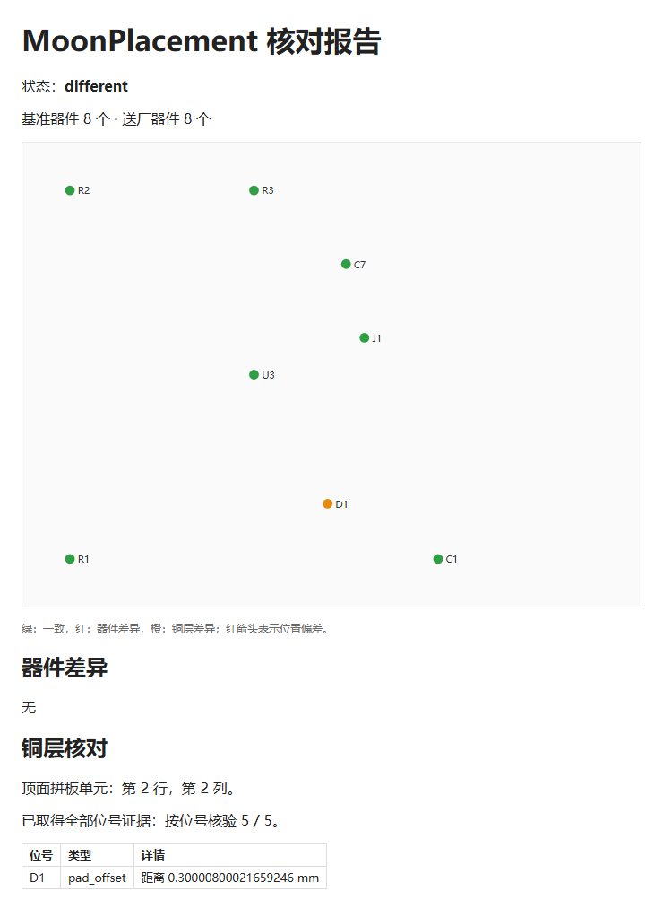

# MoonPlacement

[](https://github.com/huahai29/moonplacement/actions/workflows/check.yml)

PCB 送厂前，用 MoonPlacement 对照设计坐标表和送厂坐标表，找出漏件、多件、贴错面、偏位和角度差。手边有 Gerber 铜层的话，还能检查两张表是否把同一颗器件都标错了位置。

## 看一个例子

<!-- demo-summary:start -->

两张坐标表都把 D1 标在同一位置。只核对两表会得到 `pass`。加上 Gerber，
第 2 行第 2 列的铜层报告变为 `different`，指出 D1 偏移 **0.30 mm**。

<!-- demo-summary:end -->

[离线 HTML 报告](docs/demo/panel-d1.html)可从 GitHub 下载原文件后用浏览器打开。[复现命令](#复现报告)

[打开在线工作台](https://huahai29.github.io/moonplacement/)可直接运行 D1 示例或选择自己的文件。核对在浏览器中执行，可下载 JSON、离线 HTML 和[核验凭据](docs/receipt.md)。



## 安装并运行

安装 [MoonBit](https://www.moonbitlang.com/download/) 和 Node.js 22.3 或更新版本。CI 使用 `moonc v0.10.16+b1a0e846e`。不用安装 npm 依赖。

```sh
git clone https://github.com/huahai29/moonplacement.git
cd moonplacement
moon build --target js
node _build/js/debug/build/cmd/main/main.js examples/baseline.csv examples/delivery-ok.csv examples/policy.json
```

正常会输出 `"status": "pass"`。把送厂表换成 `examples/delivery-errors.csv`，可以看到 C7 漏件和 D1 错面。

### 复现报告

给同一对坐标表加上示例铜层，选择第 2 行第 2 列：

```sh
node _build/js/debug/build/cmd/main/main.js examples/baseline.csv examples/delivery-ok.csv examples/policy.json examples/gerber/panel-cell-2x2.gbr --panel-cell 2,2 --html _build/report.html --receipt _build/receipt.json
```

退出码 1 表示发现差异。打开 `_build/report.html` 查看 D1，或用 `_build/receipt.json` 核对报告对应的原始文件。两个选项均可省略。输出需要使用新文件名，目标目录须已存在，并支持硬链接。

## 核对自己的板子

1. 导出同一版 PCB 的设计表和送厂表，保存为 UTF-8 CSV。支持 KiCad 位置表和嘉立创 CPL 风格的列名。
2. 复制[示例配置](examples/policy.json)，填写单位、底面 X 和角度约定，选至少三颗位置分散且确认正确的器件作为对齐基准。自动判断底面 X 时，选一颗远离 X=0 的底面基准。
3. 运行上面的命令。核对铜层时，先传顶层、再传底层。Gerber 与设计坐标表须使用同一原点和坐标方向。

报告先看 `status`，再看 `differences`（两表差异）和 `pad_evidence`（铜层证据）。无法对齐时，查看 `frame.anchor_residuals` 或 `rejected_frames` 排查基准。焊盘归属来自 Gerber X2 位号；缺少归属时，附近有铜也不足以确认器件。非对称封装的贴装原点可能和铜形中心不同。

| 退出码 | 状态 | 含义 |
| --- | --- | --- |
| 0 | `pass` | 已完成所要求的核对，未发现差异 |
| 1 | `different` | 已确认差异 |
| 2 | `indeterminate` | 对齐或铜层证据不足，需复查 |
| 64 | `input_error` | 输入有误，或无法生成请求的报告 |

## 可复现案例

[0.1.1 版本与验收](docs/release-0.1.1.md)汇总库安装、实导出、拼板复现和性能数据。在 MoonBit 项目中使用时，运行 `moon add huahai29/moonplacement@0.1.1`，参考[公共 API](docs/api.md)。

- [KiCad 双面实导出](examples/README.md#铜层实导出验证)可复现两张表都标错 C7 时，铜层如何查出偏移。
- [拼板单元核对](examples/README.md#核对拼板单元)用 `--panel-cell 2,2` 定位到指定单元的 D1。[验收结果摘要](docs/acceptance-results.md)集中记录这些案例的测量值。
- [开源实板拼板验收](docs/real-panel.md)：用 KiCad 原生导出核对 2×2 实板拼板。当前主分支也可直接核对基于同一双面铜层构造的 [10×10 SR 拼板](docs/panel-benchmark.md#直接解析指定单元)。
- [块光圈与 PyGerber 对照](docs/gerber-acceptance.md#块光圈与独立对照)：核验展开前后的拼板几何，并对比 KiCad 实际导出铜层的采样点。
- [配置和报告字段](docs/audit.md) · [Gerber 2024.05 命令覆盖表](docs/gerber-acceptance.md#规范命令矩阵) · [CI 记录](https://github.com/huahai29/moonplacement/actions/workflows/check.yml)

Windows 和 Linux 的 CLI 报告会在 CI 中逐项比对，含中文路径下生成 HTML 的案例。[一致性检查](docs/platform-validation.md)

解析、配准和判定由 MoonBit 实现。Gerber 2024.05 是兼容目标，当前覆盖以验收表为准。KiCad 和 PyGerber 只用于验证样例。

| 读源码 | 入口 |
| --- | --- |
| 坐标与基准配准 | [placement.mbt](placement.mbt)、[alignment.mbt](alignment.mbt) |
| Gerber 与拼板 | [gerber.mbt](gerber.mbt)、[gerber_panel.mbt](gerber_panel.mbt) |
| 核验与报告 | [audit.mbt](audit.mbt)、[padcheck.mbt](padcheck.mbt)、[report.mbt](report.mbt) |

[架构说明](docs/architecture.md) · [报告契约 JSON](docs/接口契约.json)

[参与开发](CONTRIBUTING.md) · [第三方来源](THIRD_PARTY_NOTICES.md) · [MIT 许可证](LICENSE)
